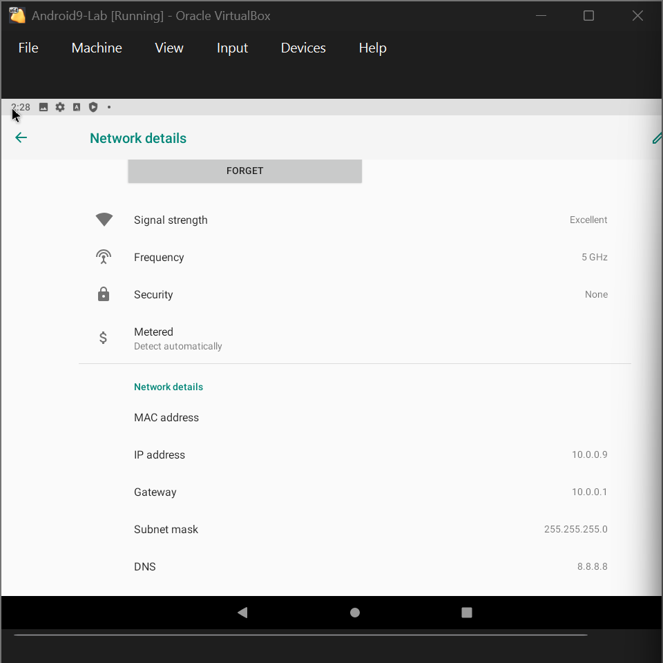
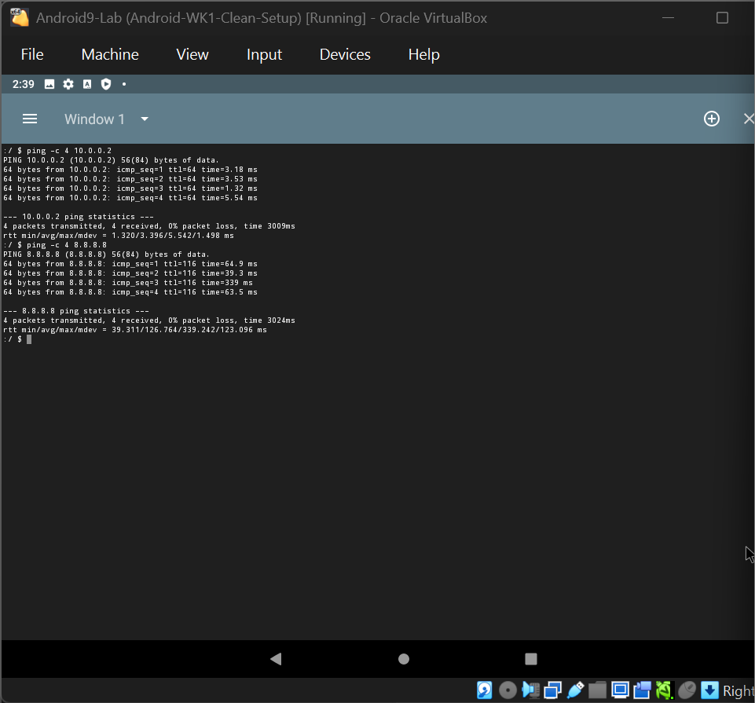
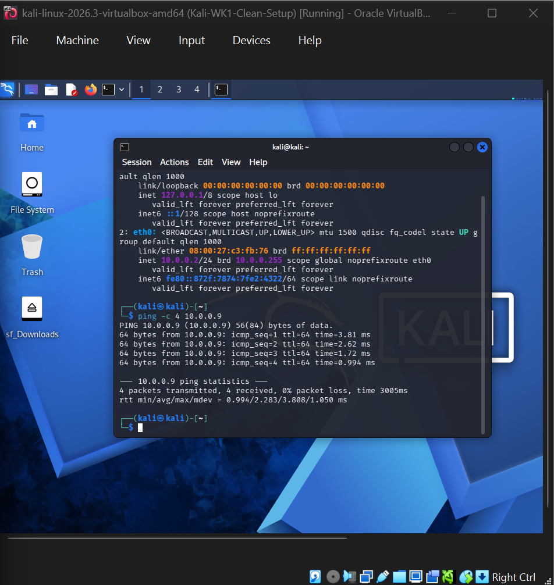

# 🔐 Cybersecurity Lab Environment Setup

**Building an isolated virtual lab for penetration testing and ethical hacking practice**


*NetworkWalks Cybersecurity Internship · Batch B084 · Week 1 · Project Module 1*

---

## 📌 Project Overview

This project focuses on building a virtual cybersecurity lab environment using Oracle VirtualBox and Kali Linux on my personal laptop.

The main objective is to create an isolated and controlled environment for cybersecurity learning, networking practice, and future penetration testing activities.

This repository documents the main project requirements, implementation steps, configuration screenshots, troubleshooting experiences, and additional learning activities completed during Week 1.

> ⚠️ **Ethics & Legality:** All activities documented in this repository were performed in my own virtual lab for educational purposes. No unauthorized systems or networks were targeted.

---

## 🎯 Main Project Objectives

The following objectives cover the main Week 1 VirtualBox and Kali Linux lab setup.

- [x] Install Oracle VirtualBox.
- [x] Import and configure Kali Linux.
- [x] Create a NAT Network using the `10.0.0.0/24` subnet.
- [x] Connect Kali Linux to the configured NAT Network.
- [x] Configure Kali Linux with a static IP address (`10.0.0.2/24`).
- [x] Enable shared clipboard and drag & drop.
- [x] Configure a shared `Downloads` folder between the host and Kali Linux.
- [x] Verify internet connectivity and DNS resolution.
- [x] Create a clean virtual machine snapshot.

---

## 🧰 Environment & Specifications

### Host Machine

| Item | Specification |
|---|---|
| Host OS | Windows 11 |
| Laptop | Dell Latitude 7300 |
| CPU | Intel Core i7-8665U (4 cores, 8 threads) |
| RAM | 16 GB DDR4 |
| Storage | 238 GB SSD (C: 119 GB, plus drive D:) |
| Virtualization | Enabled |

### Virtualization Environment

| Item | Configuration |
|---|---|
| Virtualization Software | Oracle VirtualBox 7.2.22 |
| Main Virtual Machine | Kali Linux 2026.3 |
| Allocated RAM | 4096 MB |
| Allocated CPU | 4 CPUs |
| Virtual Disk | 80 GB (Dynamic Allocation) |
| Network Type | NAT Network |
| Network Prefix | `10.0.0.0/24` |
| Gateway | `10.0.0.1` |
| DNS | `8.8.8.8` |

### Network Configuration

| Machine | Role | IP Address | Network |
|---|---|---|---|
| Kali Linux | Attacker / Analyst | `10.0.0.2/24` | NAT Network |
| Android-x86 9.0 | Target (Extra Task) | `10.0.0.9/24` | NAT Network |
| Windows 10 | Target (Planned) | `10.0.0.10/24` | NAT Network |

*Note: Android-x86 is an additional project. Windows 10 is still planned and has not been completed.*

---

## 🛠️ Main Project Implementation

### 1. VirtualBox Installation

Installed Oracle VirtualBox 7.2.22 from the official website.


### 2. NAT Network Configuration

Created a NAT Network named `NatNetwork` with the following configuration:

- Network Prefix: `10.0.0.0/24`
- DHCP: Enabled


### 3. Kali Linux Import and Network Adapter

Imported Kali Linux 2026.3 into VirtualBox and connected its network adapter to `NatNetwork`.

Promiscuous Mode was configured to **Allow All** according to the lab configuration.


### 4. Shared Clipboard, Drag & Drop, and Shared Folder

Configured the following integration features:

- Shared Clipboard: Bidirectional
- Drag & Drop: Bidirectional
- Shared Folder: Host `Downloads` directory
- Auto-mount: Enabled


To access the shared folder, I added my Kali Linux user to the `vboxsf` group:

```bash
sudo usermod -aG vboxsf $USER
sudo reboot
ls /media/sf_Downloads
```

### 5. Static IP Configuration

Initially, Kali Linux did not obtain an IP address automatically and remained stuck at:

`connecting (getting IP configuration)`

After troubleshooting, I configured a static IP address through NetworkManager using `nmcli`.

```bash
sudo nmcli connection modify "Wired connection 1" ipv4.method manual ipv4.addresses 10.0.0.2/24 ipv4.gateway 10.0.0.1 ipv4.dns 8.8.8.8 ipv4.dad-timeout 0

sudo nmcli connection up "Wired connection 1"
```

The resulting configuration:

- IP Address: `10.0.0.2/24`
- Gateway: `10.0.0.1`
- DNS: `8.8.8.8`


### 6. Internet Connectivity and DNS Verification

After configuring the static IP, I tested internet connectivity and DNS resolution.

**Ping to 8.8.8.8:**

```text
4 packets transmitted, 4 received, 0% packet loss
```

**Ping to google.com:**

```text
4 packets transmitted, 4 received, 0% packet loss
```

Both tests completed successfully.


### 7. Virtual Machine Snapshot

Created a clean snapshot named:

`Kali-WK1-Clean-Setup`

The snapshot was taken while the virtual machine was powered off to preserve the configured environment.


---

## ➕ Additional Tasks & Learning Activities

The following activities were completed as additional learning beyond the main VirtualBox and Kali Linux setup.

They are documented separately and should not be confused with the main Week 1 project requirements.

### 1. Android-x86 9.0 Virtual Machine

As an additional networking practice, I installed Android-x86 9.0 in VirtualBox and connected it to the same NAT Network.

**Virtual Machine Configuration:**

| Item | Configuration |
|---|---|
| VM Name | Android9-Lab |
| Operating System | Linux |
| Version | Other Linux 64-bit |
| RAM | 2048 MB |
| Virtual Disk | Approximately 10 GB |
| Network | NAT Network |
| Graphics Controller | VBoxVGA |
| 3D Acceleration | Disabled |
| Static IP | `10.0.0.9/24` |
| Snapshot | Android-WK1-Clean-Setup |

I initially followed the recommended display settings in the lab guide, including enabling 3D Acceleration. However, Android-x86 got stuck on the Android boot screen during startup.

After troubleshooting and adjusting the VirtualBox display configuration, I was able to boot Android-x86 successfully with 3D Acceleration disabled. The virtual machine then worked properly, and I successfully completed the network connectivity tests.

The VM initially received `10.0.0.4` through DHCP. I then configured the static IP address `10.0.0.9/24`.

**Connectivity Testing:**

| Test | Result |
|---|---|
| Android → Kali (`10.0.0.2`) | 0% packet loss |
| Android → Internet (`8.8.8.8`) | 0% packet loss |
| Kali → Android (`10.0.0.9`) | 0% packet loss |







### 2. Wireshark SOC Labs

As another additional learning activity, I completed six browser-based Wireshark SOC Labs.

Each lab contained 10 tasks involving network traffic investigation and analysis.

**Results:**

| Lab | Title | Skills Practiced | Score |
|---|---|---|---|
| 3 | Identify the Attacker's IP | Filtering TCP SYN packets and identifying attacker and target IPs | 100/100 |
| 4 | Follow TCP Stream 1 | Reconstructing and analyzing a plain-text conversation | 100/100 |
| 5 | Follow TCP Stream, Part 2 | Finding hidden HTML comments and downloaded text files | 100/100 |
| 6 | HTTP Plain Text Credentials | Identifying credentials transmitted through HTTP POST requests | 100/100 |
| 7 | Catch the Brute Force Attacker | Detecting repeated FTP login attempts | 100/100 |
| 8 | Catch the Call Scammer | Investigating captured VoIP traffic and identifying the scammer | 100/100 |

**Total: 6 Labs · 60 Tasks · 600/600 Points**

#### Wireshark Display Filters

Some of the display filters I practiced during the labs:

```text
tcp.flags.syn == 1
```

```text
tcp && !(tcp.port == 80 || tcp.port == 443)
```

```text
http.request.method == "POST"
```

```text
ftp.response.code == 530
```

#### Lab Result Screenshots

| Lab 3 | Lab 4 | Lab 5 |
|:---:|:---:|:---:|
|  |  |  |

| Lab 6 | Lab 7 | Lab 8 |
|:---:|:---:|:---:|
|  |  |  |

### 3. Windows 10 Virtual Machine (In Progress)

The Windows 10 virtual machine is an additional setup that I attempted but have not completed yet.

During installation, I encountered the following error:

`Windows cannot find the Microsoft Software License Terms.`

Troubleshooting attempts included:

- Downloading a new Windows 10 ISO.
- Checking the ISO file integrity.
- Disabling Hyper-V-related Windows features.

However, the installation issue persisted.

**Planned Configuration:**

| Item | Configuration |
|---|---|
| VM Name | Windows10-Lab |
| RAM | 4096 MB |
| Virtual Disk | 40 GB |
| Network | NAT Network |
| Planned IP | `10.0.0.10/24` |

I will update this repository once the Windows 10 virtual machine is successfully installed and configured.

---

## 🧯 Troubleshooting & Challenges

During the setup process, I encountered several technical issues. Here are the problems and the solutions I applied.

### 1. Kali Linux Could Not Obtain an IP Address

**Problem:**

The network interface `eth0` remained stuck at:

`connecting (getting IP configuration)`

**Solution:**

After trying different network configurations, I configured a static IP through `nmcli` and adjusted the duplicate address detection timeout using:

`ipv4.dad-timeout 0`

After applying the configuration, Kali Linux successfully connected to the network and passed the internet and DNS connectivity tests.


### 2. Kali Linux Black Screen After Reboot

**Problem:**

After adding my user to the `vboxsf` group, Kali Linux displayed a black screen during reboot.

**Solution:**

I used **Machine > Reset** in VirtualBox. The virtual machine then booted normally.

### 3. Limited Storage on Drive C

**Problem:**

My C drive had limited available storage for virtual machines and downloaded installation files.

**Solution:**

I moved VM files, downloads, and snapshots to drive D to manage storage more efficiently.

### 4. Promiscuous Mode Configuration

**Problem:**

The network adapter's Promiscuous Mode was initially set to `Deny`.

**Solution:**

I changed it to `Allow All` to match the lab configuration.

### 5. Wireshark Lab 3 Initial Score

**Problem:**

My first attempt at Wireshark Lab 3 resulted in a score of 90%.

**Solution:**

I reviewed the questions more carefully, repeated the lab, and achieved 100/100.

### 6. Windows 10 Installation Error

**Problem:**

The Windows 10 installer displayed:

`Windows cannot find the Microsoft Software License Terms.`

**Solution / Current Status:**

I tried a new ISO file, checked its integrity, and disabled Hyper-V-related features. However, the problem remained unresolved. This VM is still in progress.

---

## 📚 Lessons Learned

This project gave me practical experience in setting up a virtual cybersecurity environment and troubleshooting networking issues.

Some of my key takeaways:

- Before starting this project, I thought building a cybersecurity lab required a gaming laptop. I learned that a laptop with appropriate specifications can run multiple virtual machines with careful resource management.
- I gained hands-on experience configuring virtual networks, static IP addresses, shared folders, and virtual machine snapshots.
- This was my first experience with Wireshark. I was surprised that the SOC labs could be completed directly in a browser, and I especially enjoyed the packet analysis challenges.
- An unencrypted protocol such as HTTP or FTP can expose sensitive information when traffic is intercepted. This helped me understand the importance of encrypted communication.
- Troubleshooting is an important part of learning. Not every configuration works on the first attempt, and documenting problems helps me understand how to solve them.

**My advice to anyone starting out:**

Just give it a try. If something feels difficult, do not give up. Take a break, review the problem, and continue learning step by step.

---

## 📂 Repository Structure

```text
NETWORKWALKS-MARLIANA-B084-WK1-PM1-CYBERSECURITY-LAB-SETUP/
│
├── README.md
│
└── screenshots/
    │
    ├── kali linux/
    │   ├── 01-virtualbox-installed.png
    │   ├── 02-natnetwork.png
    │   ├── 03-kali-imported.png
    │   ├── 04-kali-nat-network-adapter.png
    │   ├── 05a-shared-clipboard.png
    │   ├── 05b-drag-and-drop.png
    │   ├── 06b-shared-folder-configured.png
    │   ├── 06c-shared-folder-mounted.png
    │   ├── 07a-kali-ip-address.png
    │   ├── 07b-kali-manual-ip-settings.png
    │   ├── 08a-internet-test-ping-ip.png
    │   ├── 08b-internet-test-ping-dns.png
    │   ├── 09-vm-snapshot-taken.png
    │   ├── 10a-troubleshooting-connecting.png
    │   └── 10b-troubleshooting-fix-nmcli.png
    │
    ├── android/
    │   ├── 01-android-general-os-memory.png
    │   ├── 02-android-storage-iso-vdi.png
    │   ├── 03-android-network-natnetwork.png
    │   ├── 04-android-display-settings.png
    │   ├── 05-android-installer-boot-menu.png
    │   ├── 06-android-partition-sda1-written.png
    │   ├── 07-android-grub-installed.png
    │   ├── 08-android-first-boot.png
    │   ├── 09-android-ip-before-dhcp.png
    │   ├── 10-android-static-ip-form.png
    │   ├── 11-android-ip-after-static-10.0.0.9.png
    │   ├── 12-android-ping-kali-and-internet.png
    │   ├── 12b-kali-ping-android.png
    │   └── 13-android-vm-snapshot.png
    │
    └── wireshark/
        ├── Lab 3 Result - Marliana.png
        ├── Lab 4 Result - Marliana.png
        ├── Lab 5 Result - Marliana.png
        ├── Lab 6 Result - Marliana.png
        ├── Lab 7 Result - Marliana.png
        └── Lab 8 Result - Marliana.png
```

---

## 🙏 Acknowledgement

Thank you to **Waqas Karim (CCIE)** and **NetworkWalks** for providing the learning materials, guidance, and opportunity to gain hands-on cybersecurity experience.

**NetworkWalks Cybersecurity Internship · Batch B084 · Week 1**

*All activities were performed in my own virtual lab for educational purposes.*
