<div align="center">

# 🔐 Cybersecurity Lab Environment Setup

**Building an isolated virtual lab for penetration testing and ethical hacking practice**

      

*Networkwalks Cybersecurity Internship · Batch B084 · Week 1 · Project Module 1 + Extras*

</div>

---

## 📌 Project Overview

This project sets up a **virtual cybersecurity and penetration-testing laboratory** on my own laptop using VirtualBox and Kali Linux.

The lab is a controlled, private environment where scanning, reconnaissance, traffic analysis and other security-testing activities can be practiced **safely and repeatably**. All machines sit on a private NAT Network so more targets can be added later.

> ⚠️ **Ethics & legality:** Every machine in this lab is my own virtual machine, running on my own device. Nothing in this project was tested against systems I do not own or have written permission to test.

---

## 🎯 Objectives

- [x] Install VirtualBox as the virtualization base
- [x] Import and configure Kali Linux as the attacker machine
- [x] Create a custom NAT Network in subnet `10.0.0.0/24`
- [x] Enable shared clipboard and drag & drop
- [x] Share the host `Downloads` folder with Kali
- [x] Give Kali the static IP `10.0.0.2/24` with full Internet access
- [x] Take a clean snapshot of the VM
- [x] Extra: Android-x86 9.0 VM on the same NAT Network, tested with ping in both directions
- [x] Extra: 6 Wireshark SOC labs (Labs 3 to 8), all completed with 100/100
- [ ] Extra: Windows 10 VM (not completed yet, will be added in an update)

---

## 🗺️ Lab Architecture

```
                 Host machine (Windows 10)
 ┌────────────────────────────────────────────────────────┐
 │  VirtualBox   ·   NAT Network "NatNetwork" 10.0.0.0/24 │
 │                                                        │
 │   Kali Linux  10.0.0.2   (attacker / analyst)          │
 │   Android-x86 10.0.0.9   (target, extra)               │
 │   more target VMs can be added to the same network     │
 │                                                        │
 │   Gateway: 10.0.0.1          DNS: 8.8.8.8              │
 └────────────────────────────────────────────────────────┘
```

| Machine | Role | IP Address | Network |
|---|---|---|---|
| Kali Linux | Attacker / analyst | `10.0.0.2/24` | NAT Network |
| Android-x86 9.0 (extra) | Target | `10.0.0.9/24` | NAT Network |

---

## 🧰 Environment

| Item | Version / Detail |
|---|---|
| Host OS | Windows 10 |
| Kali VM resources | 4096 MB RAM, 4 CPU, 80 GB dynamic disk (VDI) |
| VirtualBox | 7.2.22 |
| Kali Linux | 2026.3 (Rolling, x64) |
| VM storage location | Disk D (system disk was full) |

---

## 🛠️ Implementation — Phase 1 (Required)

### Step 1 — Install 7-Zip
Used to extract the Kali Linux VirtualBox archive (`.7z`).

### Step 2 — Install VirtualBox
Downloaded from the official VirtualBox site and installed (version 7.2.22).


### Step 3 — Create the NAT Network
`File > Tools > Network > NAT Networks > Create`

| Setting | Value |
|---|---|
| Name | `NatNetwork` |
| IPv4 Prefix | `10.0.0.0/24` |
| Enable DHCP | ✅ |
| Enable IPv6 | ❌ |


### Step 4 — Import Kali Linux
Imported the pre-built Kali Linux 2026.3 VirtualBox image and kept the VM files on drive D (the system drive C was full).


### Step 5 — Configure the VM settings

| Setting | Value |
|---|---|
| Network → Attached to | NAT Network → `NatNetwork` |
| Promiscuous Mode | Allow All |
| Shared Clipboard | Bidirectional |
| Drag'n'Drop | Bidirectional |
| Shared Folder | Host `Downloads` folder, name `Downloads`, Auto-mount, Machine-permanent, Full access |


To use the shared folder in Kali, the user was added to the `vboxsf` group and the VM was restarted:

```bash
sudo usermod -aG vboxsf $USER
sudo reboot
ls /media/sf_Downloads
```


### Step 6 — Static IP inside Kali
The network menu showed *disconnected* and `eth0` was stuck in "connecting (getting IP configuration)", so the static IP was set from the terminal with `nmcli` (details in Troubleshooting):

```bash
sudo nmcli connection modify "Wired connection 1" ipv4.method manual ipv4.addresses 10.0.0.2/24 ipv4.gateway 10.0.0.1 ipv4.dns 8.8.8.8 ipv4.dad-timeout 0
sudo nmcli connection up "Wired connection 1"
```

| Field | Value |
|---|---|
| Method | Manual |
| Address | `10.0.0.2` |
| Netmask | `24` |
| Gateway | `10.0.0.1` |
| DNS | `8.8.8.8` |


### Step 7 — Verify
```bash
ip a
ping -c 4 8.8.8.8
ping -c 4 google.com
```

**Output (from my Kali VM):**
```
2: eth0: <BROADCAST,MULTICAST,UP,LOWER_UP> mtu 1500 qdisc fq_codel state UP
    inet 10.0.0.2/24 brd 10.0.0.255 scope global noprefixroute eth0

--- 8.8.8.8 ping statistics ---
4 packets transmitted, 4 received, 0% packet loss, time 3018ms

--- google.com ping statistics ---
4 packets transmitted, 4 received, 0% packet loss, time 3028ms
```
Pinging a domain name worked too, so both Internet access and DNS are fine.


### Step 8 — Snapshot
Powered off the VM and took a snapshot named `Kali-WK1-Clean-Setup` of the clean, working state so I can always roll back after experiments.


---

## ➕ Extra Tasks

### 1. Android-x86 9.0 VM ✅

| Setting | Value |
|---|---|
| VM name / type | `Android9-Lab` · Linux, Other Linux (64-bit) |
| ISO | `android-x86_64-9.0-r2.iso` |
| Memory / disk | 2048 MB RAM · about 10 GB dynamic VDI |
| Network | NAT Network `NatNetwork`, Promiscuous Mode: Allow All |
| Display | VBoxVGA, 3D acceleration off, 16 MB video memory (as shown in the lab slides) |
| Install | Installed to hard disk (partition `sda1`) with GRUB |
| IP address | Static `10.0.0.9/24` · gateway `10.0.0.1` · DNS `8.8.8.8` (DHCP had given `10.0.0.4` on first boot) |

Connectivity tests (4 packets each, 0% packet loss):
```
Android -> Kali     (10.0.0.2)   4 transmitted, 4 received, 0% packet loss
Android -> Internet (8.8.8.8)    4 transmitted, 4 received, 0% packet loss
Kali    -> Android  (10.0.0.9)   4 transmitted, 4 received, 0% packet loss
```
A snapshot named `Android-WK1-Clean-Setup` was taken after the setup worked.

**Screenshots (VM settings, installer, first boot, static IP, ping tests, snapshot):**

| | | |
|:-:|:-:|:-:|
| 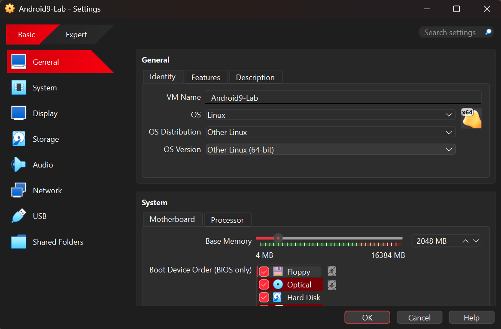<br>General | 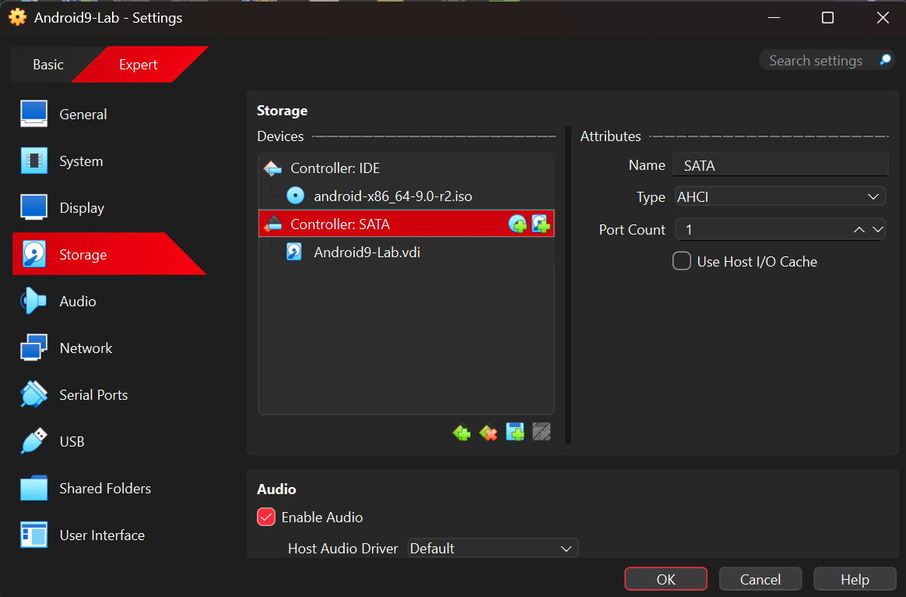<br>Storage | 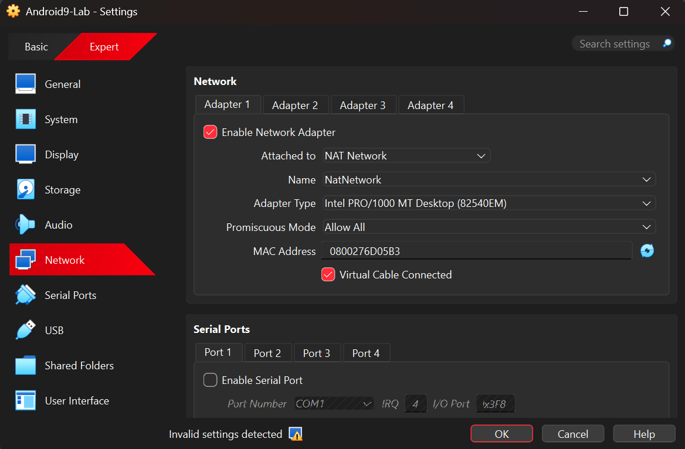<br>Network |
| 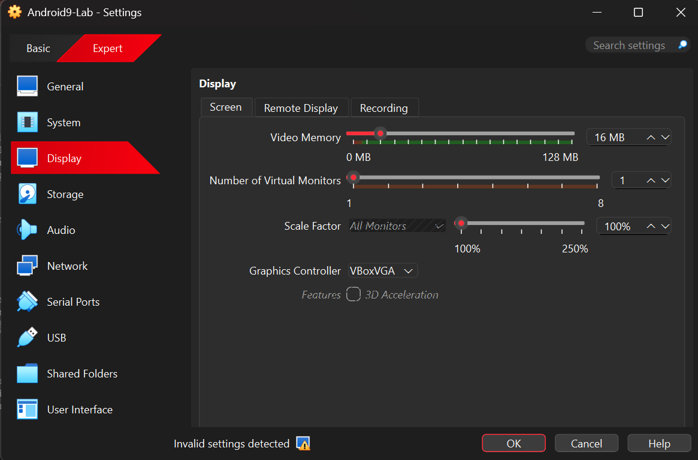<br>Display | 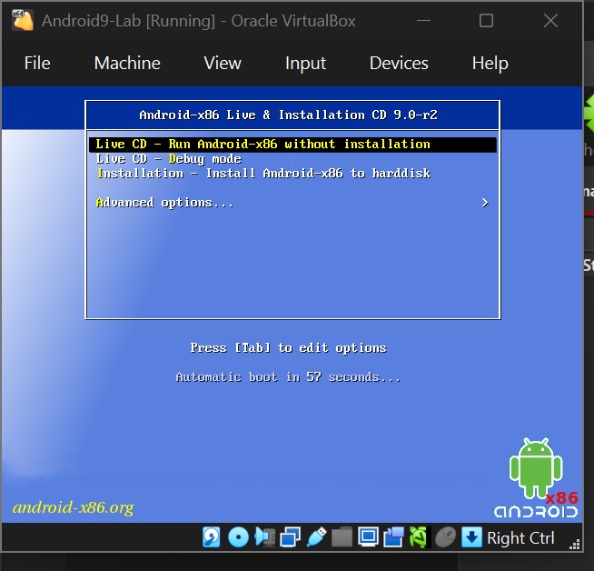<br>Installer | 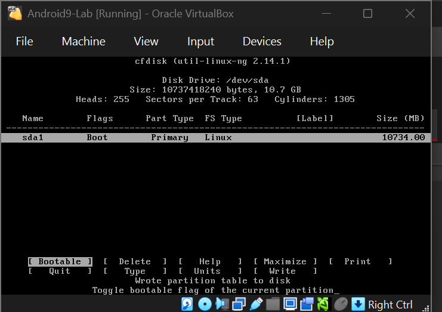<br>Partition |
| 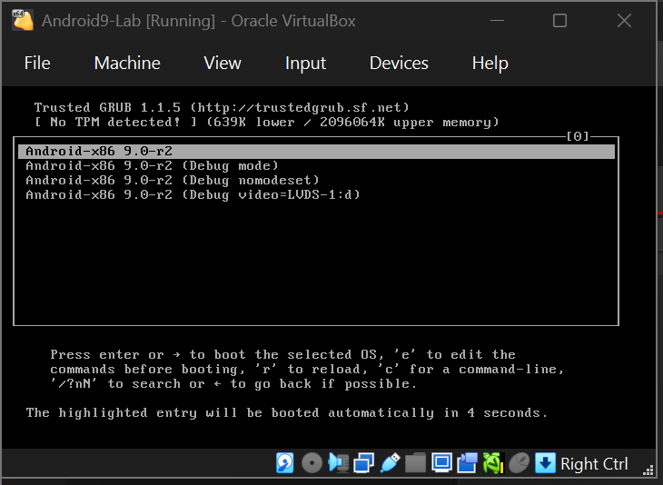<br>GRUB | 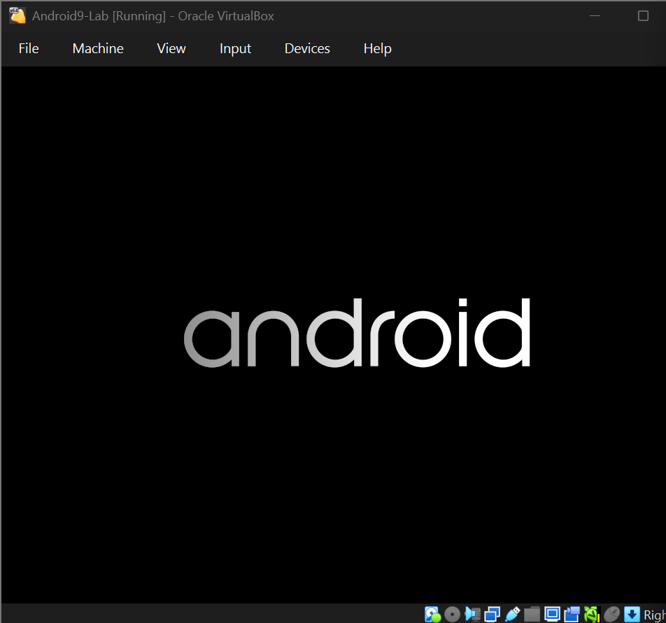<br>First boot | 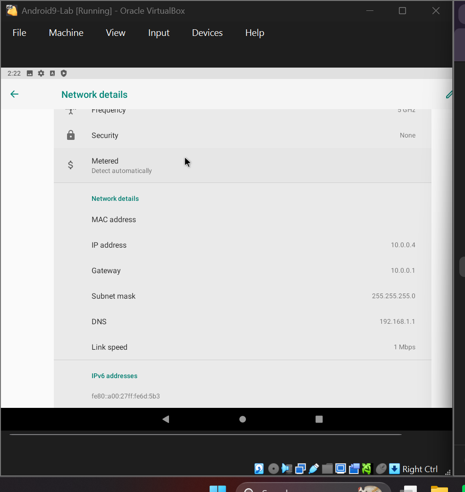<br>IP from DHCP |
| 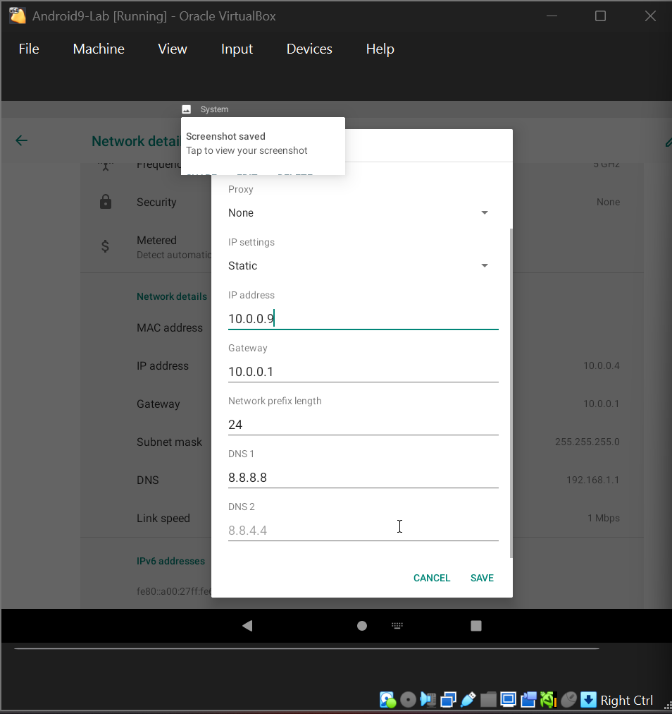<br>Static IP form | <br>Static IP set | <br>Android pings |
| <br>Kali pings Android | 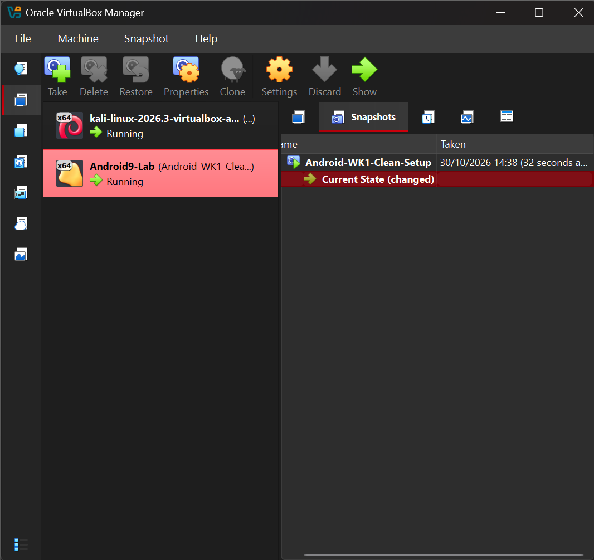<br>Snapshot | |

### 2. Wireshark SOC Labs ✅
Completed the 6 browser-based Wireshark labs (10 tasks each). Every lab was finished with **100 / 100**.

| Lab | Title | Skill practiced | Score |
|---|---|---|---|
| 3 | Identify the Attacker's IP | Recognising a port scan in captured traffic | 100/100 |
| 4 | Follow TCP Stream | Rebuilding a conversation from a TCP stream | 100/100 |
| 5 | Follow TCP Stream, Part 2 | Finding hidden data and downloaded files in streams | 100/100 |
| 6 | HTTP Plain Text Credentials | Spotting clear-text logins over HTTP | 100/100 |
| 7 | Brute Force Catch | Detecting repeated failed logins followed by a success | 100/100 |
| 8 | VoIP Call Replay | Investigating a captured VoIP call | 100/100 |

**Example workflow (Lab 3):** I counted the captured packets, then used display filters on TCP flags to separate connection attempts (SYN), replies from open ports (SYN, ACK) and replies from closed ports (RST, ACK). One internal host sent a long burst of SYN packets from one fixed source port to many different ports of a single server, which identifies a **TCP SYN port scan** (reconnaissance).

Filters used as building blocks:
```
tcp.flags.syn == 1 && tcp.flags.ack == 0      # connection attempts (SYN only)
tcp.flags.syn == 1 && tcp.flags.ack == 1      # replies from open ports
tcp.flags.reset == 1                          # replies from closed ports
ip.src == <address>                           # traffic from one host
```

**Result pages:**

| Lab 3 | Lab 4 | Lab 5 |
|:-:|:-:|:-:|
|  |  |  |

| Lab 6 | Lab 7 | Lab 8 |
|:-:|:-:|:-:|
|  |  |  |

### 3. Windows 10 VM ⏳
Not completed yet. It will be added to this repository (planned address `10.0.0.10/24` on the same NAT Network) in a later update.

---

## 🧯 Troubleshooting

### Problem 1: Kali showed "disconnected" and had no IP
`nmcli device status` showed `eth0` stuck in *connecting (getting IP configuration)*, and the network menu could not be used. The adapter settings in VirtualBox were already correct (NAT Network `NatNetwork`, cable connected).

**Fix:** set the static IP from the terminal and disable duplicate-address detection delay (the fix recommended for VirtualBox 7 with recent Kali versions):
```bash
sudo nmcli connection modify "Wired connection 1" ipv4.method manual ipv4.addresses 10.0.0.2/24 ipv4.gateway 10.0.0.1 ipv4.dns 8.8.8.8 ipv4.dad-timeout 0
sudo nmcli connection up "Wired connection 1"
```
After this, `eth0` came up with `10.0.0.2/24` and Internet and DNS worked.


### Problem 2: Kali hung while rebooting
After adding my user to the `vboxsf` group and running `sudo reboot`, the VM stayed on a black screen with VirtualBox guest-service errors. Waiting did not help, so I used **Machine > Reset**; Kali then booted normally and the shared folder was mounted.

### Problem 3: System drive C was full
I kept the VM and its disk on drive D and used the same drive for downloads and snapshots.

---

## 📚 Lessons Learned

From this project I learned how to build a safe place to practice cybersecurity. Putting Kali Linux and the other virtual machines on a private NAT Network keeps them separated from my home network, so I can try things without risking my real devices. I also learned that a snapshot is very useful, because it gives me a clean working state to go back to if something breaks later. From the Wireshark labs I learned that network traffic tells a story: a port scan shows many SYN packets coming from one source, open ports answer with SYN-ACK, and closed ports answer with RST. I also saw how easy it is to read usernames and passwords from plain-text protocols like HTTP, which shows why encryption such as HTTPS is so important.

## 🧗 Challenges I Faced

The first difficulty was storage, because my C drive was full. I solved it by keeping the VM files, downloads and snapshots on drive D. The next problem was that Kali showed "disconnected" and could not get an IP address. The network menu could not be used, so I fixed it from the terminal with `nmcli`: I set the static IP and turned off the duplicate-address detection timeout, and then the internet worked.

After I added my user to the `vboxsf` group and rebooted, Kali froze on a black screen, so I had to use Machine > Reset to restart it. I was also confused by the VirtualBox menus at first. I had to learn that the Devices menu is in the VM window (not in the VirtualBox Manager) and that I need Expert mode to see all the adapter options. I also noticed that Promiscuous Mode was still on "Deny", so I changed it to "Allow All" to match the requirement.

In Wireshark Lab 3, one answer was wrong in my first attempt and I got 90%. I ran the lab again, read the question more carefully, and got 100%. Because of the deadline, I did not finish the Windows 10 VM yet, and I plan to add it later.

These problems taught me to check one layer at a time, to read each question carefully, and to confirm my answer with real data before I submit it.

---

## 📁 Repository Structure

```
.
├── README.md
└── screenshots/
    ├── 01-virtualbox-installed.png
    ├── 02-natnetwork.png
    ├── 03-kali-imported.png
    ├── 04-kali-nat-network-adapter.png
    ├── 05a-shared-clipboard.png
    ├── 05b-drag-and-drop.png
    ├── 06a-shared-folder-add-share.png
    ├── 06b-shared-folder-configured.png
    ├── 06c-shared-folder-mounted.png
    ├── 07a-kali-ip-address.png
    ├── 07b-kali-manual-ip-settings.png
    ├── 08a-internet-test-ping-ip.png
    ├── 08b-internet-test-ping-dns.png
    ├── 09-vm-snapshot-taken.png
    ├── 10a-troubleshooting-connecting.png
    ├── 10b-troubleshooting-fix-nmcli.png
    ├── android/      (14 screenshots)
    └── wireshark/    (lab3-result.png ... lab8-result.png)
```

---

<div align="center">

**Networkwalks Cybersecurity Internship · Instructor: Waqas Karim CCIE**
*All activity performed on my own virtual lab for educational purposes.*

</div>
