 <div align="center">

# 🛡️ Cybersecurity Lab Environment Setup

### Kali Linux Installation and Network Configuration


**NetworkWalks Cybersecurity Internship 2026**

**Batch B084 | Week 1 | Main Project**

</div>

---

## 🔐 Project Overview

This project presents the process of preparing a Kali Linux virtual environment using Oracle VM VirtualBox as part of the NetworkWalks Cybersecurity Internship 2026, Batch B084, Week 1.

The lab focuses on setting up a functional virtual machine, configuring its network environment, enabling communication between the host and guest systems, and checking internet connectivity.

In addition to the initial setup, this project documents the network configuration issue encountered during the process and the solution implemented to establish a working connection.

The resulting environment serves as a starting point for learning Linux system administration, network fundamentals, and practical cybersecurity activities.

## 🎯 Objectives

The main objectives of this project are:

- Install and prepare Kali Linux in Oracle VM VirtualBox.
- Configure a NAT Network to provide network access to the virtual machine.
- Set up a static IP address for Kali Linux.
- Enable shared clipboard and drag-and-drop functionality.
- Configure a shared folder between Windows and Kali Linux.
- Test network connectivity and external internet access.
- Create a virtual machine snapshot for recovery purposes.
- Understand basic network configuration and troubleshooting in a Linux environment.

## 🧪 Purpose of the Lab

The purpose of this lab is to establish a controlled virtual environment for cybersecurity learning and technical experimentation.

Kali Linux provides a Linux-based environment commonly used for security testing, network analysis, and other cybersecurity-related activities.

Running Kali Linux through VirtualBox makes it possible to practice within a virtual machine without replacing the host operating system. It also allows the virtual environment to be configured independently while maintaining selected connections with the host.

This setup provides the basic infrastructure needed before proceeding to more advanced cybersecurity exercises.

## 🏗️ Lab Architecture

The environment consists of a Windows 11 host machine running Kali Linux through Oracle VM VirtualBox.

The virtual machine is connected to a NAT Network, allowing it to access external networks and communicate with other virtual machines connected to the same network.

### Network Topology

```text
                 INTERNET
                    |
             NAT NETWORK
                    |
          Network: 10.0.0.0/24
                    |
            Gateway: 10.0.0.1
                    |
          +--------------------+
          |    KALI LINUX      |
          |                    |
          |  IP: 10.0.0.2/24  |
          |  DNS: 8.8.8.8     |
          +--------------------+
                    |
           VirtualBox Integration
                    |
          +--------------------+
          |    WINDOWS 11      |
          |    HOST MACHINE    |
          +--------------------+
```

### Network Components

| Component | Configuration |
|---|---|
| Host Operating System | Windows 11 |
| Guest Operating System | Kali Linux 2026.3 |
| Virtualization Platform | Oracle VM VirtualBox |
| Network Mode | NAT Network |
| Network Name | NatNetwork |
| Network Prefix | 10.0.0.0/24 |
| Gateway | 10.0.0.1 |
| Kali Linux IP | 10.0.0.2 |
| DNS Server | 8.8.8.8 |

## ⚙️ Lab Configuration

### 1. Host Machine Specifications

The physical device used for this lab has the following specifications:

| Component | Specification |
|---|---|
| Device | Dell Latitude 7300 |
| Operating System | Windows 11 |
| Processor | Intel Core i7-8665U |
| CPU | 4 Cores / 8 Threads |
| Memory | 16 GB DDR4 |
| Storage | 238 GB SSD |

### 2. Virtual Machine Specifications

The Kali Linux virtual machine was configured with the following resources:

| Component | Configuration |
|---|---|
| Virtualization Software | VirtualBox 7.2.22 |
| Operating System | Kali Linux 2026.3 |
| Base Memory | 4096 MB |
| Processors | 4 CPUs |
| Virtual Disk | 80 GB |
| Storage Type | Dynamically Allocated |
| Network Adapter | NAT Network |
| Network Name | NatNetwork |

### 3. Network Configuration

The NAT Network was configured with the following settings:

| Setting | Value |
|---|---|
| Network Name | NatNetwork |
| IPv4 Prefix | 10.0.0.0/24 |
| Gateway | 10.0.0.1 |
| DNS | 8.8.8.8 |
| Kali IP Address | 10.0.0.2 |

### 4. VirtualBox Integration Settings

The following integration features were enabled:

| Feature | Configuration |
|---|---|
| Shared Clipboard | Bidirectional |
| Drag and Drop | Bidirectional |
| Shared Folder | Windows Downloads |
| Guest Mount Point | /media/sf_Downloads |

These features simplify file exchange and interaction between the Windows host and Kali Linux guest system.

## 🚀 Lab Setup Procedure

### Step 1 – Install VirtualBox

Oracle VM VirtualBox version 7.2.22 was installed on the Windows 11 host machine.

VirtualBox was selected as the virtualization platform to provide an isolated environment for running Kali Linux.

### Step 2 – Create a NAT Network

A dedicated NAT Network was created through VirtualBox Network Manager.

The network was named `NatNetwork` and configured using the IPv4 prefix `10.0.0.0/24`.

The gateway was configured as `10.0.0.1`, with `8.8.8.8` as the DNS server.

### Step 3 – Import Kali Linux

Kali Linux 2026.3 was imported into VirtualBox.

After importing, the virtual machine resources were configured according to the available host hardware:

- 4096 MB RAM
- 4 virtual CPUs
- 80 GB dynamically allocated virtual disk

The virtual machine's network adapter was also connected to the previously created `NatNetwork`.

### Step 4 – Configure Shared Clipboard and Drag and Drop

The VirtualBox integration settings were adjusted to support communication between the host and guest operating systems.

Both Shared Clipboard and Drag and Drop were set to `Bidirectional`.

This configuration allows supported text and file transfer operations between Windows and Kali Linux.

### Step 5 – Configure a Shared Folder

The Windows Downloads folder was configured as a shared folder for the Kali Linux virtual machine.

The shared directory was made accessible inside Kali Linux through:

```bash
/media/sf_Downloads
```

The current user was added to the `vboxsf` group to obtain the required shared-folder permissions:

```bash
sudo usermod -aG vboxsf $USER
```

After updating the group membership, the user session was refreshed to apply the permission changes.

### Step 6 – Configure a Static IP Address

During the initial network setup, Kali Linux remained in the connecting state while attempting to obtain its IP configuration automatically.

To establish the required network configuration, a static IPv4 address was assigned through NetworkManager.

The connection profile was configured with:

- IP Address: `10.0.0.2/24`
- Gateway: `10.0.0.1`
- DNS Server: `8.8.8.8`
- IPv4 Method: Manual

The following command was used:

```bash
sudo nmcli connection modify "Wired connection 1" \
ipv4.method manual \
ipv4.addresses 10.0.0.2/24 \
ipv4.gateway 10.0.0.1 \
ipv4.dns 8.8.8.8 \
ipv4.dad-timeout 0
```

The updated connection profile was then activated:

```bash
sudo nmcli connection up "Wired connection 1"
```

This applied the manual network configuration to the Kali Linux interface.

### Step 7 – Verify the Network Configuration

The network interface configuration was checked to confirm that the expected IP address had been assigned.

The following command can be used to inspect the interface configuration:

```bash
ip addr show
```

The configured Kali Linux address was:

```text
10.0.0.2/24
```

### Step 8 – Test Internet Connectivity

Internet connectivity was tested using the `ping` utility.

First, an external IP address was tested:

```bash
ping -c 4 8.8.8.8
```

A domain name was also tested to check connectivity using DNS resolution:

```bash
ping -c 4 google.com
```

Both tests completed successfully with 0% packet loss.

### Step 9 – Create a Virtual Machine Snapshot

After completing the main configuration and connectivity checks, a snapshot was created in VirtualBox.

The snapshot was named:

```text
Kali-WK1-Clean-Setup
```

This snapshot preserves the configured virtual machine state and provides a convenient recovery point for subsequent lab activities.

## ✅ Lab Verification

The following table summarizes the configuration and verification results from the lab.

| Verification Item | Result |
|---|---|
| VirtualBox Installation | Completed |
| Kali Linux Import | Completed |
| NAT Network Configuration | Completed |
| Static IP Configuration | Successful |
| Shared Clipboard | Configured |
| Drag and Drop | Configured |
| Shared Folder | Mounted |
| Ping to 8.8.8.8 | Successful |
| Ping to google.com | Successful |
| Packet Loss | 0% |
| Virtual Machine Snapshot | Created |

### Connectivity Test Results

The following connectivity checks were performed:

**1. External IP Connectivity**

```bash
ping -c 4 8.8.8.8
```

Result: Successful response from the external IP address.

**2. Domain Name Connectivity**

```bash
ping -c 4 google.com
```

Result: Successful response using the domain name.

These tests confirmed that the Kali Linux virtual machine could access the internet after the network configuration was applied.

## 🛠️ Problems Encountered & Solutions

### Problem: Network Interface Stuck on Connecting

During the initial network setup, the Kali Linux network interface remained in the connecting state with the message:

```text
Connecting (getting IP configuration)
```

The expected IP configuration was not obtained automatically.

### Solution: Manual Network Configuration

The issue was addressed by configuring a static IPv4 address through NetworkManager.

The following settings were applied:

| Parameter | Value |
|---|---|
| IPv4 Method | Manual |
| IP Address | 10.0.0.2/24 |
| Gateway | 10.0.0.1 |
| DNS | 8.8.8.8 |

The network connection was then reactivated using:

```bash
sudo nmcli connection up "Wired connection 1"
```

After applying the configuration, the network connection was successfully activated and internet connectivity tests were completed.

### Troubleshooting Outcome

This troubleshooting process provided practical experience in configuring Linux network interfaces, managing NetworkManager connection profiles, and diagnosing basic connectivity problems.

## 📚 What I Learned

Through this lab, I gained practical experience in several areas:

- Installing and managing a Linux virtual machine using VirtualBox.
- Understanding the basic functionality of NAT Network.
- Configuring static IPv4 addresses in Kali Linux.
- Using NetworkManager through the `nmcli` command-line utility.
- Enabling communication and file exchange between host and guest systems.
- Configuring shared folders and Linux group permissions.
- Testing network connectivity using the `ping` command.
- Understanding the importance of DNS in accessing services through domain names.
- Creating snapshots to preserve a working virtual machine configuration.
- Troubleshooting network connection issues in a Linux environment.

This lab helped strengthen my understanding of virtualization and basic networking as essential foundations for cybersecurity practice.

## 🔒 Security & Ethical Use

All activities in this lab were conducted within a controlled virtual environment for educational purposes.

Kali Linux provides tools that can be used for security assessment and penetration testing. However, these tools must only be used on systems, networks, and devices for which proper authorization has been obtained.

The knowledge gained from this lab is intended to support responsible cybersecurity learning, technical development, and ethical security practices.

## 🖼️ Project Screenshots

The following screenshots document the installation, configuration, network testing, and troubleshooting activities performed during this project.

### 1. VirtualBox Installation and Network Setup

| Screenshot | Description |
|---|---|
| 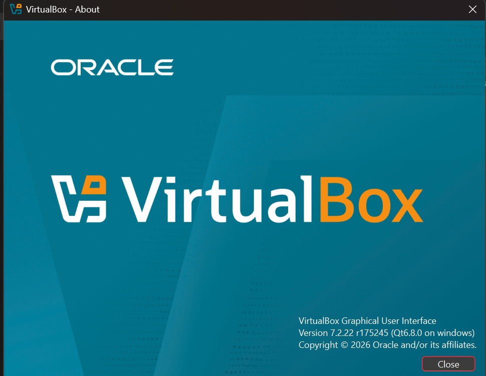 | VirtualBox installation |
| 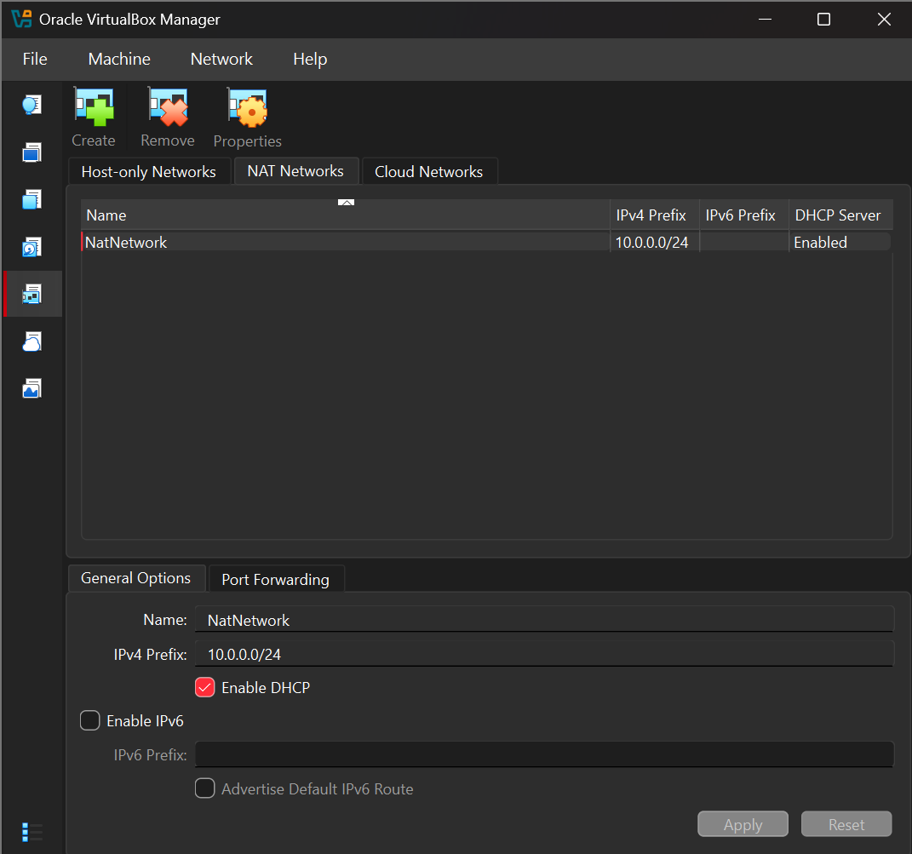 | NAT Network configuration |
| 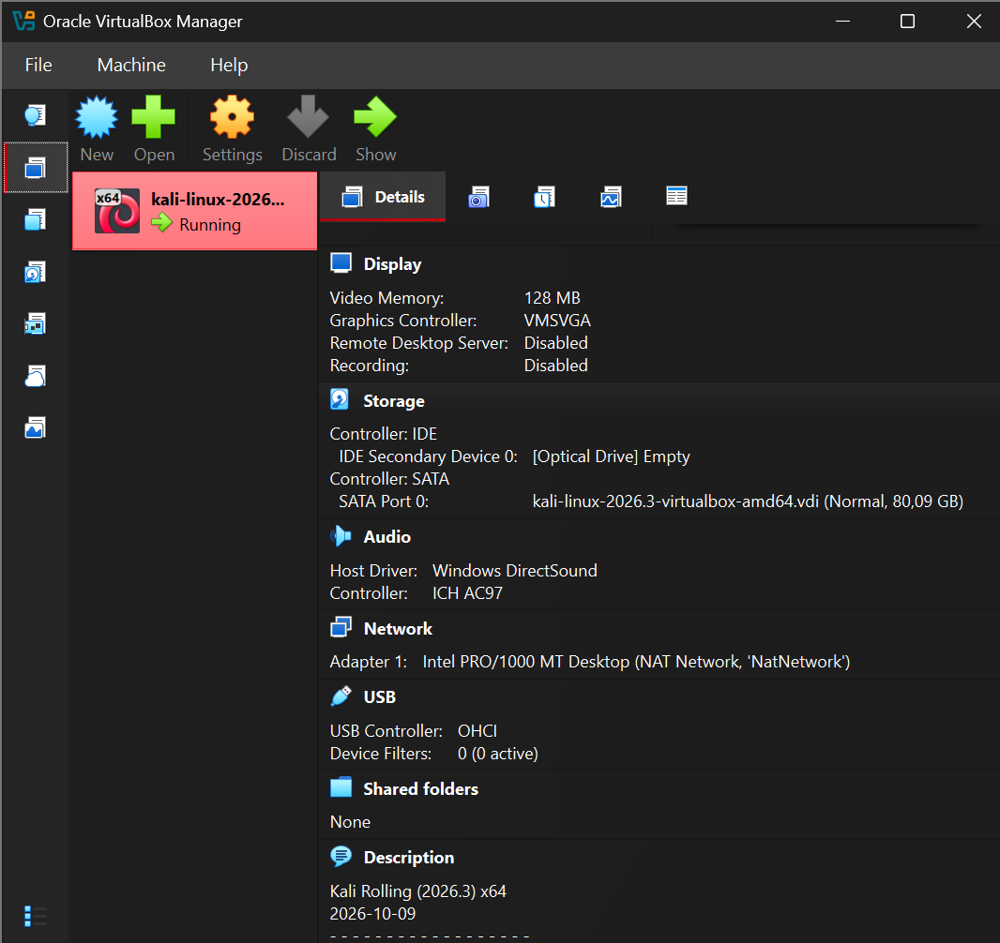 | Kali Linux imported into VirtualBox |
| 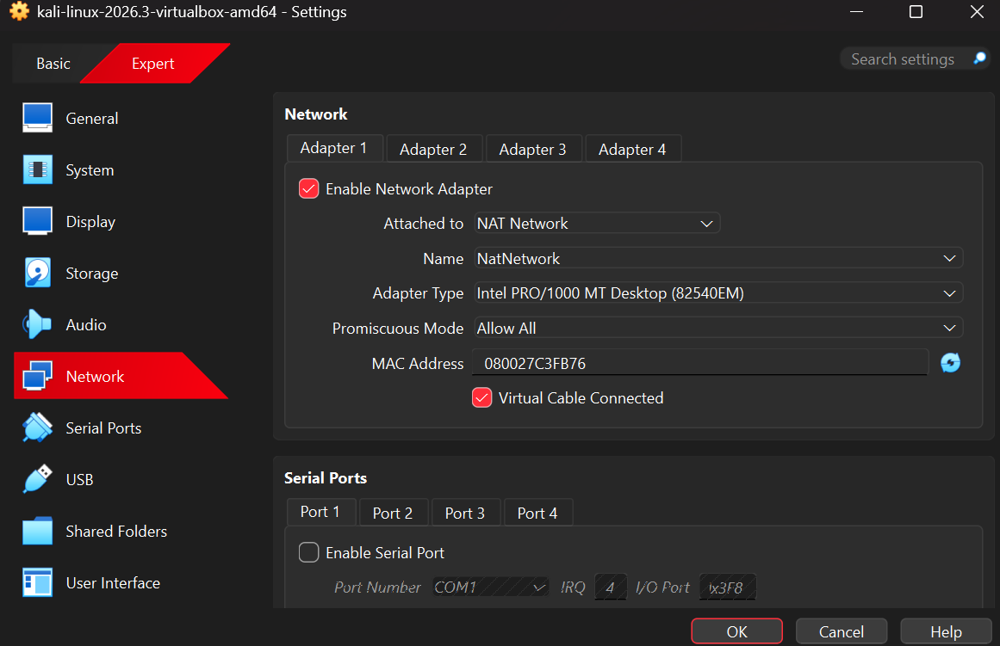 | Virtual machine network adapter configuration |

### 2. Host–Guest Integration

| Screenshot | Description |
|---|---|
| 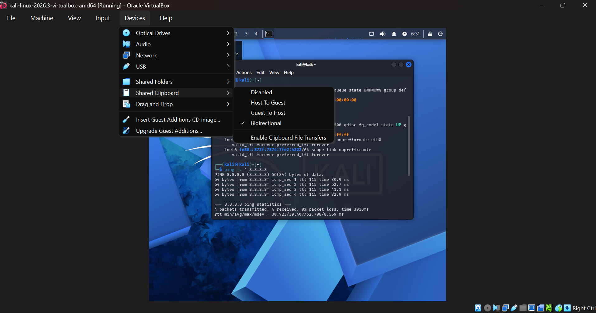 | Shared Clipboard configuration |
| 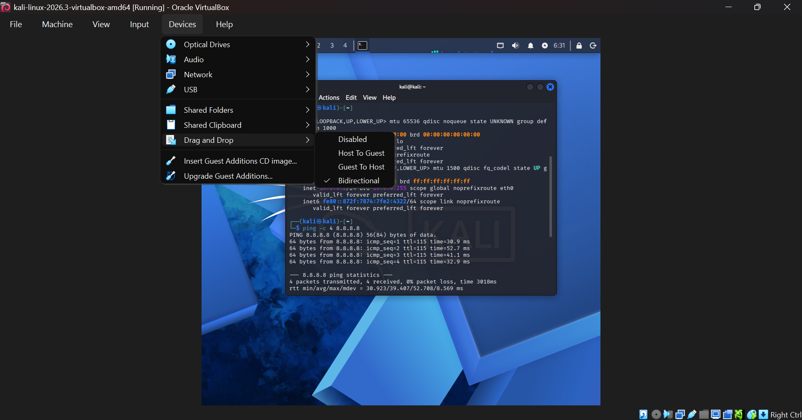 | Drag and Drop configuration |
| 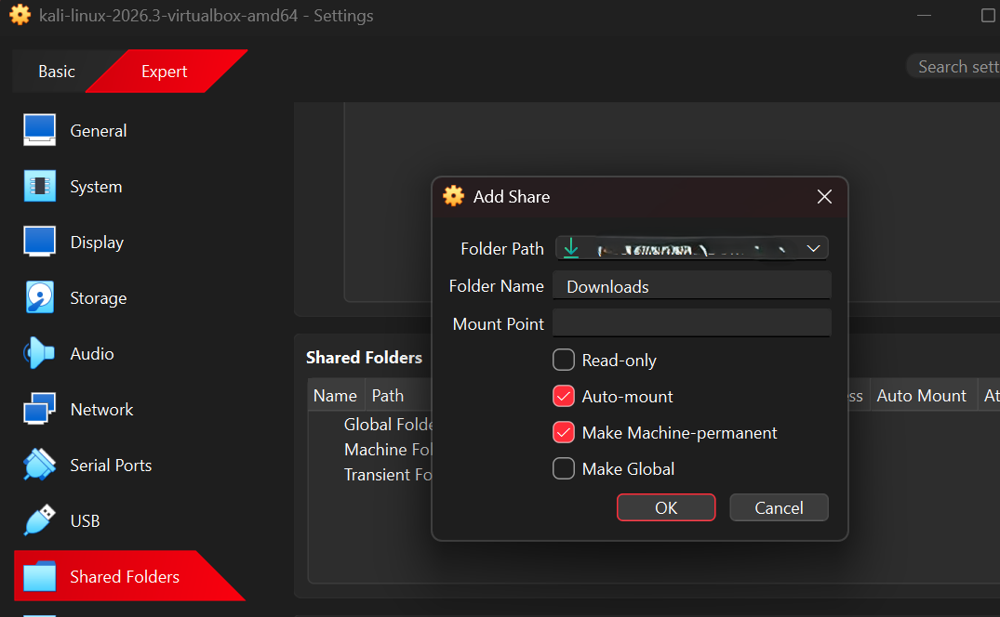 | Adding the shared folder |
|  | Shared folder configuration |
| 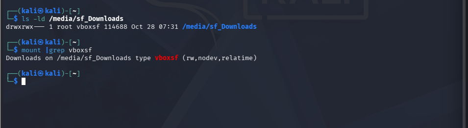 | Shared folder mounted in Kali Linux |

### 3. Network Configuration and Connectivity

| Screenshot | Description |
|---|---|
| 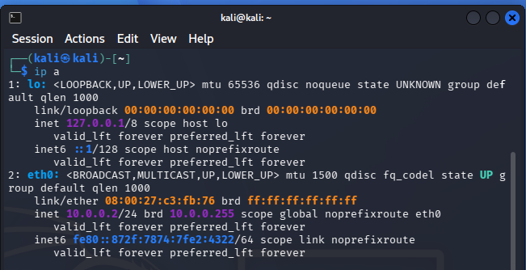 | Kali Linux IP address |
| 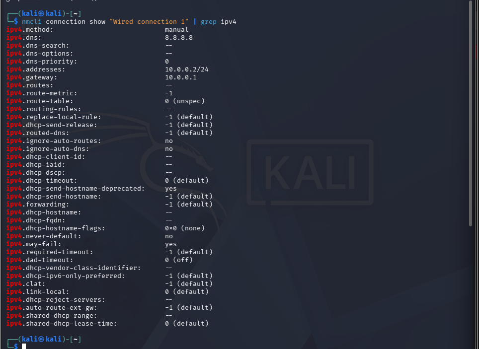 | Manual IPv4 configuration |
| 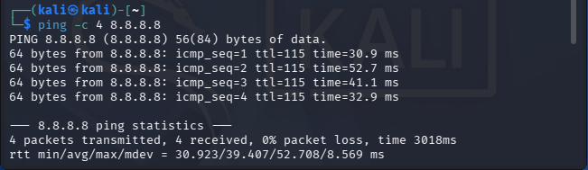 | Internet connectivity test using an IP address |
| 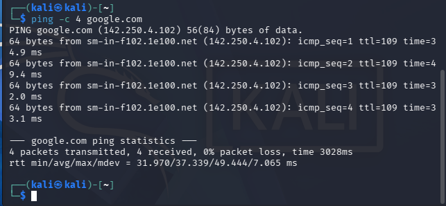 | Connectivity test using a domain name |

### 4. Snapshot and Troubleshooting

| Screenshot | Description |
|---|---|
| 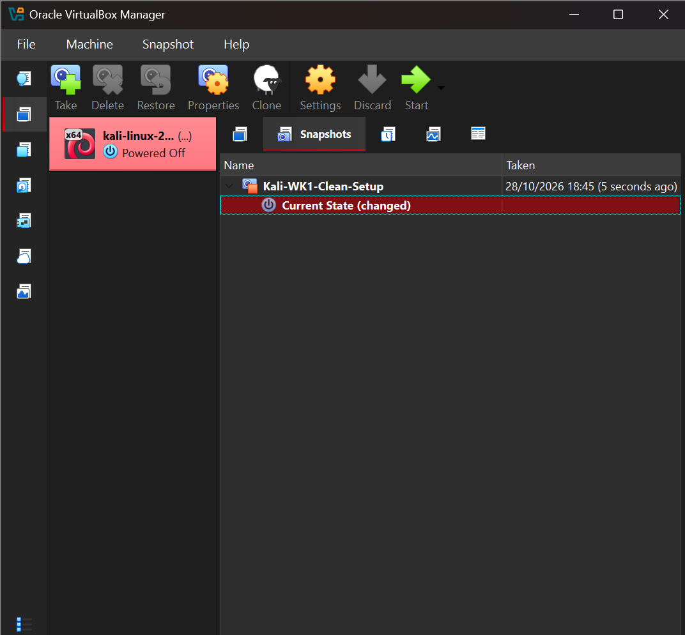 | Kali Linux snapshot |
| 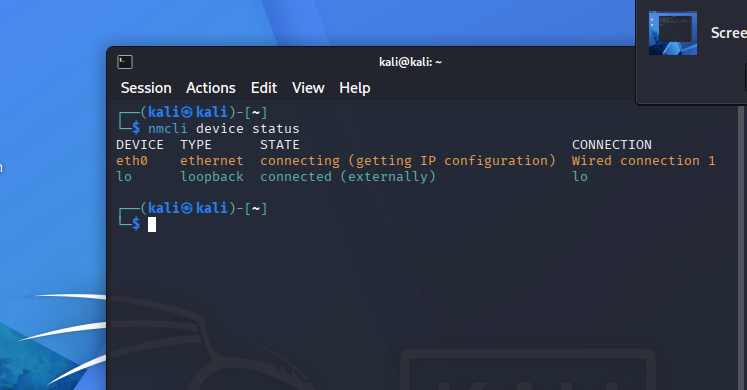 | Initial network connection issue |
| 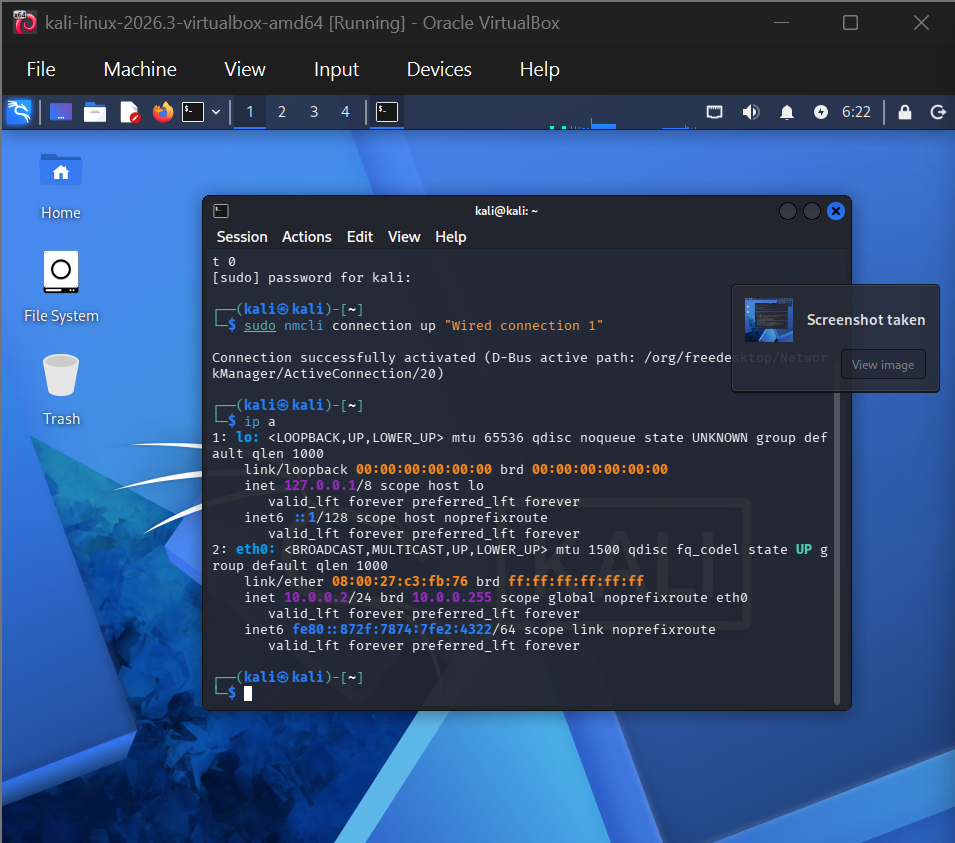 | Manual network configuration using nmcli |

**Note:** The screenshots above represent the activities for which visual documentation was captured. Other configuration steps that were completed but not individually captured are described in the setup procedure.

## 🧰 Tools & Resources

### Tools Used

| Tool | Purpose |
|---|---|
| Oracle VM VirtualBox 7.2.22 | Virtualization platform |
| Kali Linux 2026.3 | Guest operating system |
| Windows 11 | Host operating system |
| NetworkManager | Linux network management |
| nmcli | Command-line network configuration |
| VirtualBox Shared Folders | Host–guest file exchange |

### Learning Resources

- [Kali Linux Official Website](https://www.kali.org/)
- [Kali Linux Documentation](https://www.kali.org/docs/)
- [Oracle VM VirtualBox](https://www.virtualbox.org/)
- [VirtualBox User Manual](https://www.virtualbox.org/manual/)
- [NetworkManager Documentation](https://networkmanager.dev/docs/)

## 👩‍💻 Author

**Marliana**

Participant of NetworkWalks Cybersecurity Internship 2026 – Batch B084.

Interested in cybersecurity, digital forensics, backend development, and full-stack development.

## 📌 Project Information

| Information | Details |
|---|---|
| Program | NetworkWalks Cybersecurity Internship 2026 |
| Batch | B084 |
| Week | Week 1 |
| Project Type | Main Project |
| Project Topic | Kali Linux Lab Environment Setup |
| Virtualization Platform | Oracle VM VirtualBox |
| Guest Operating System | Kali Linux 2026.3 |
| Host Operating System | Windows 11 |

### Acknowledgement

I would like to express my appreciation to **NetworkWalks** and **Waqas Karim (CCIE)** for providing the learning materials, guidance, and opportunity to gain practical experience in cybersecurity.

This project represents my hands-on learning process and the knowledge gained while preparing a Kali Linux environment for cybersecurity practice.

---

<div align="center">

**NetworkWalks Cybersecurity Internship 2026**

*Learn • Practice • Explore • Secure*

</div>
